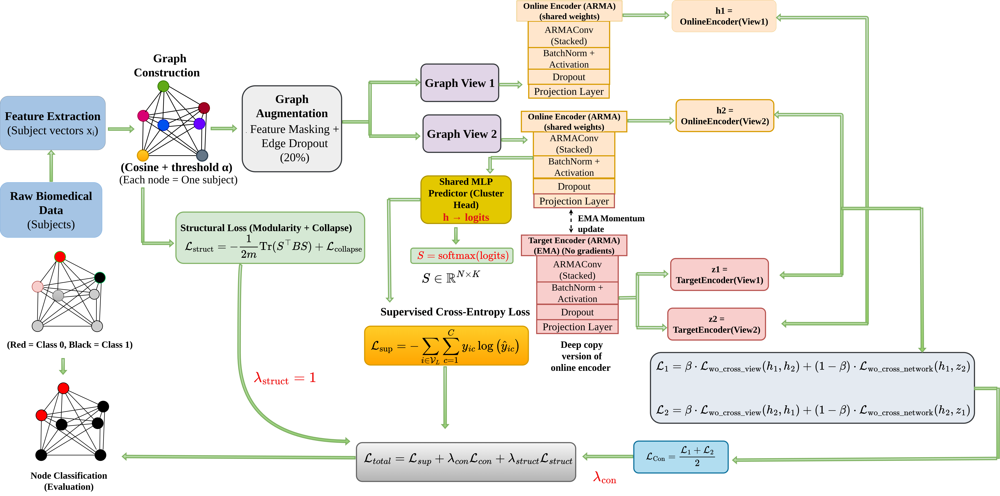

# ARMA-C3: Semi-Supervised Graph Learning for Biomedical Classification

**ARMA-C3** is a semi-supervised graph learning framework for biomedical classification with limited labeled data. It combines ARMA graph convolution, contrastive representation learning, and modularity-based structural regularization to learn informative representations from labeled and unlabeled subjects.

The framework is evaluated on five biomedical classification datasets covering neuroimaging, breast ultrasound, liver ultrasound, and chest X-ray imaging.

> **Research Paper:** *ARMA-C3: A Contrastive ARMA Convolutional Framework for Semi-Supervised Graph Learning for Biomedical Classification*  
> **Conference:** 17th Indian Conference on Computer Vision, Graphics and Image Processing (ICVGIP 2026)

---

## Table of Contents

- [Overview](#overview)
- [Architecture](#architecture)
- [Key Contributions](#key-contributions)
- [Methodology](#methodology)
- [Datasets](#datasets)
- [Experimental Results](#experimental-results)
- [Repository Structure](#repository-structure)
- [Getting Started](#getting-started)
- [Running the Notebooks](#running-the-notebooks)
- [Implementation Details](#implementation-details)
- [Data Availability](#data-availability)
- [Limitations](#limitations)
- [Citation](#citation)
- [Acknowledgments](#acknowledgments)
- [Contact](#contact)

---

## Overview

Biomedical classification models often require large amounts of labeled data, but expert annotations can be expensive and difficult to obtain. This challenge is particularly important in neuroimaging and medical image analysis, where datasets may also exhibit class imbalance, high-dimensional features, and complex relationships between subjects.

ARMA-C3 addresses this challenge through **semi-supervised graph learning**. Each subject is represented as a node in a population graph, and relationships between subjects are modeled using feature similarity.

The framework combines three complementary components:

1. **ARMA Graph Convolution:** Learns node representations by propagating information across the population graph.
2. **Contrastive Representation Learning:** Encourages consistent representations across augmented graph views using a MERIT-style teacher–student framework.
3. **Modularity-Based Structural Regularization:** Encourages meaningful community structure and preserves important relationships within the graph.

These components are jointly optimized with a supervised classification objective. Unlabeled nodes contribute to graph propagation and representation learning, allowing the framework to exploit information beyond the labeled training samples.

The method is evaluated on five binary classification tasks:

- **ADNI:** Cognitively Normal vs. Mild Cognitive Impairment
- **NIFD:** Healthy Controls vs. Frontotemporal Dementia
- **BreastMNIST:** Normal/Benign vs. Malignant
- **Liver Ultrasound:** Benign vs. Malignant
- **PneumoniaMNIST:** Normal vs. Pneumonia

The experimental protocol uses a limited-label setting, with 10% labeled training data and 90% testing data, averaged over 20-fold cross-validation as reported in the paper.

---

## Architecture

The following diagram illustrates the overall ARMA-C3 framework, including feature extraction, population graph construction, graph augmentation, ARMA encoding, contrastive learning, structural regularization, and classification.



**Figure 1.** Overview of the proposed ARMA-C3 framework for semi-supervised graph learning.

### Main stages

1. **Feature Extraction:** Extract subject-level features from biomedical images or diffusion MRI.
2. **Population Graph Construction:** Build a graph using similarity between subject representations.
3. **Joint Representation Learning:** Combine supervised classification, contrastive learning, and structural regularization.
4. **Classification:** Use the learned graph representations to predict the target class.

---

## Key Contributions

- **Semi-supervised biomedical classification:** Learns from a small subset of labeled subjects while exploiting unlabeled nodes.
- **ARMA-based graph representation learning:** Captures relationships between subjects through graph convolution.
- **Contrastive learning:** Improves representation consistency across augmented graph views.
- **Structural regularization:** Encourages meaningful graph community structure through modularity-based regularization.
- **Cross-modality evaluation:** Evaluates the framework across diffusion MRI, ultrasound, and chest X-ray datasets.
- **Label-efficient learning:** Investigates classification performance when only 10% of the data is labeled for training.

---

## Methodology

### 1. Feature Extraction

The framework uses different feature extraction strategies depending on the dataset modality.

| Dataset | Modality | Feature Representation |
|---|---|---|
| ADNI | Diffusion MRI | Fractional Anisotropy (FA) histogram features |
| NIFD | Diffusion MRI | Fractional Anisotropy (FA) histogram features |
| BreastMNIST | Breast ultrasound | Frozen pretrained ViT-DINO embeddings |
| Liver Ultrasound | Liver ultrasound | Frozen pretrained ViT-DINO embeddings |
| PneumoniaMNIST | Chest X-ray | Frozen pretrained ResNet-18 embeddings |

For ADNI and NIFD, FA histogram descriptors represent regional white-matter characteristics. For the image-based datasets, frozen pretrained visual encoders generate compact image representations.

### 2. Population Graph Construction

Each subject is represented as a node in a population graph. Pairwise cosine similarity is used to measure the similarity between subject feature representations.

A similarity threshold determines which relationships are retained in the graph. Relationships below the threshold are removed, producing a sparse adjacency structure.

The resulting graph represents relationships between subjects and serves as the input to the graph learning framework.

### 3. ARMA Graph Encoder

ARMA graph convolution propagates information across connected subjects to learn topology-aware node representations.

The encoder captures information from neighboring nodes while modeling relationships across the population graph. The learned representations are passed to a classifier to produce class predictions.

### 4. Contrastive Representation Learning

The framework uses a MERIT-style teacher–student approach to improve representation robustness.

Two augmented graph views are generated using:

- Node feature masking
- Edge dropout

The online encoder processes the augmented views, while an exponential moving average (EMA) teacher provides target representations.

The contrastive objective encourages consistency between representations obtained from different graph views and between the online encoder and teacher.

### 5. Modularity-Based Structural Regularization

The structural regularization objective encourages the model to preserve meaningful community structure in the population graph.

It uses predicted class assignments and graph connectivity to promote structural consistency and reduce undesirable representation collapse.

### 6. Joint Optimization

The model jointly optimizes three objectives:

- **Supervised classification loss:** Encourages correct predictions on labeled training samples.
- **Contrastive learning loss:** Encourages consistent representations across augmented graph views.
- **Structural regularization loss:** Encourages meaningful graph community structure.

The contributions of the contrastive and structural objectives are controlled by their respective weighting parameters.

This combined learning strategy enables classification supervision, representation consistency, and graph structure preservation to contribute to training.

---

## Datasets

ARMA-C3 is evaluated on five binary biomedical classification tasks.

| Dataset | Classification Task | Modality | Number of Samples |
|---|---|---|---:|
| ADNI | Cognitively Normal vs. MCI | Diffusion MRI | 300 |
| NIFD | Healthy Controls vs. FTD | Diffusion MRI | 146 |
| BreastMNIST | Normal/Benign vs. Malignant | Breast ultrasound | 780 |
| Liver Ultrasound | Benign vs. Malignant | Ultrasound | 635 |
| PneumoniaMNIST | Normal vs. Pneumonia | Chest X-ray | 3,583 |

### Dataset details

- **ADNI:** 300 subjects, including 133 cognitively normal subjects and 167 subjects with Mild Cognitive Impairment.
- **NIFD:** 146 subjects, including 98 patients with Frontotemporal Dementia and 48 healthy controls.
- **BreastMNIST:** 780 images. The binary classification task combines normal and benign cases and classifies them against malignant cases.
- **Liver Ultrasound:** 635 images comprising benign and malignant lesions.
- **PneumoniaMNIST:** A subset of 3,583 images, including 2,000 normal images and 1,583 pneumonia images.

The ADNI and NIFD datasets are associated with their respective research initiatives. BreastMNIST and PneumoniaMNIST are part of the MedMNIST benchmark.

Please consult the original dataset sources and their terms of use before downloading or redistributing data.

---

## Experimental Results

The following table reports the ARMA-C3 classification results presented in the paper.

Results are reported as **mean ± standard deviation over 20-fold cross-validation**.

| Dataset | Accuracy | Precision | Recall | F1-score |
|---|---:|---:|---:|---:|
| ADNI (CN vs. MCI) | 0.807 ± 0.02 | 0.819 ± 0.05 | 0.822 ± 0.05 | 0.817 ± 0.02 |
| NIFD | 0.723 ± 0.05 | 0.812 ± 0.05 | 0.771 ± 0.07 | 0.789 ± 0.04 |
| BreastMNIST | 0.855 ± 0.02 | 0.890 ± 0.02 | 0.917 ± 0.03 | 0.902 ± 0.01 |
| Liver Ultrasound | 0.785 ± 0.02 | 0.818 ± 0.03 | 0.866 ± 0.04 | 0.841 ± 0.01 |
| PneumoniaMNIST | 0.944 ± 0.01 | 0.952 ± 0.01 | 0.948 ± 0.01 | 0.950 ± 0.01 |

### Main observations

- **ADNI:** ARMA-C3 achieves an F1-score of 0.817 using the sparse-label evaluation protocol.
- **NIFD:** The framework achieves an F1-score of 0.789 on a relatively small neuroimaging dataset.
- **BreastMNIST:** The framework achieves an F1-score of 0.902.
- **Liver Ultrasound:** The framework achieves an F1-score of 0.841.
- **PneumoniaMNIST:** The framework achieves an F1-score of 0.950.

The results demonstrate the applicability of the proposed framework across different biomedical imaging modalities under limited-label supervision.

### Comparison with a supervised ARMA baseline

The paper also compares ARMA-C3 against a supervised ARMA baseline trained using 90% labeled data.

| Dataset | ARMA-C3 F1-score | Supervised ARMA F1-score |
|---|---:|---:|
| ADNI | 0.817 | 0.815 |
| NIFD | 0.789 | 0.671 |
| BreastMNIST | 0.902 | 0.943 |
| Liver Ultrasound | 0.841 | 0.875 |
| PneumoniaMNIST | 0.950 | 0.963 |

The supervised baseline uses a different training protocol, with 90% training data and 10% testing data. ARMA-C3 uses 10% labeled training data and exploits the remaining unlabeled samples through graph learning.

These results should therefore be interpreted in the context of the different label-availability settings rather than as a direct comparison under identical supervision.

---

## Repository Structure

The repository contains the experimental notebooks, extracted feature arrays, and architecture diagram.

```text
ARMA-C3-Biomedical-Classification/
│
├── README.md
├── .gitignore
├── updated_ARMAC3.drawio.png
│
├── Semisupervised_Classification/
│   │
│   ├── ADNI (CN_MCI)/
│   │   └── ADNI experimental notebooks
│   │
│   ├── NIFD/
│   │   └── NIFD experimental notebooks
│   │
│   ├── BreastMNIST/
│   │   └── BreastMNIST experimental notebooks
│   │
│   ├── Liver/
│   │   └── Liver Ultrasound experimental notebooks
│   │
│   └── PneumoniaMNIST/
│       └── PneumoniaMNIST experimental notebooks
│
├── NIFD_Control_FA_Histogram_Feature.npy
├── NIFD_Patients_FA_Histogram_Feature.npy
├── cn_image_features_updated.npy
├── mci_image_features_updated.npy
├── liver_dino_features.npy
└── liver_dino_labels.npy
```

### Main components

| Component | Description |
|---|---|
| `Semisupervised_Classification/` | Dataset-specific experimental notebooks |
| `ADNI (CN_MCI)/` | ADNI cognitively normal versus MCI experiments |
| `NIFD/` | NIFD control versus patient experiments |
| `BreastMNIST/` | Breast ultrasound classification experiments |
| `Liver/` | Liver ultrasound classification experiments |
| `PneumoniaMNIST/` | Chest X-ray classification experiments |
| `updated_ARMAC3.drawio.png` | ARMA-C3 architecture diagram |
| `.npy` files | Stored feature arrays and labels used by selected experiments |

The directory tree above is illustrative. Refer to the actual repository for the complete list of notebook files.

---

## Getting Started

### Requirements

The experiments use Python and Jupyter notebooks. The exact package versions should match the environment used for the reported experiments.

Common packages for this workflow include:

- Python
- Jupyter Notebook or JupyterLab
- NumPy
- pandas
- scikit-learn
- PyTorch
- PyTorch Geometric
- Matplotlib

Additional packages may be required for image processing, feature extraction, or diffusion MRI preprocessing.

**Note:** This list is a starting point, not a verified list of the exact dependencies for every notebook. Check the notebook imports and execution cells before preparing the environment.

### Clone the repository

```bash
git clone https://github.com/tejaswi-abburi1083/ARMA-C3-Biomedical-Classification.git
cd ARMA-C3-Biomedical-Classification
```

### Create a Python environment

Using Conda:

```bash
conda create -n arma-c3 python=3.10
conda activate arma-c3
```

Python 3.10 is a suggested starting point, not a claim about the exact original experimental environment.

### Install Jupyter

```bash
python -m pip install jupyter
```

Install the remaining dependencies according to the imports and requirements of the notebook you intend to run.

### Launch Jupyter Notebook

```bash
jupyter notebook
```

Open the relevant notebook from the `Semisupervised_Classification/` directory.

---

## Running the Notebooks

Experiments are organized by dataset.

| Dataset | Directory |
|---|---|
| ADNI | `Semisupervised_Classification/ADNI (CN_MCI)/` |
| NIFD | `Semisupervised_Classification/NIFD/` |
| BreastMNIST | `Semisupervised_Classification/BreastMNIST/` |
| Liver Ultrasound | `Semisupervised_Classification/Liver/` |
| PneumoniaMNIST | `Semisupervised_Classification/PneumoniaMNIST/` |

### Suggested workflow

1. Clone the repository.
2. Install the dependencies required by the selected notebook.
3. Open the dataset-specific directory.
4. Identify the notebook corresponding to the experiment.
5. Verify the input feature paths and dataset availability.
6. Run the notebook cells in order.
7. Record the evaluation metrics and experimental configuration.

Some notebooks may rely on precomputed feature files or data stored outside the repository. Check the notebook paths and data-loading cells before execution.

### Reproducibility notes

For meaningful comparisons with the paper, ensure that:

- The same dataset and preprocessing procedure are used.
- Graph construction settings match the experiment.
- The labeled-data protocol is preserved.
- Model hyperparameters are consistent with the reported configuration.
- The evaluation procedure matches the reported 20-fold cross-validation protocol.
- Random seeds and data splits are recorded where applicable.

The reported results should not be assumed to reproduce exactly until the experimental environment, inputs, and evaluation procedures have been verified.

---

## Implementation Details

The paper reports the following shared implementation choices and dataset-specific settings.

### Shared settings

| Parameter | Setting |
|---|---|
| ARMA graph convolution layers | 3 |
| Hidden dimension | 256 |
| Classifier | Two-layer MLP |
| Optimizer | AdamW |
| Initial learning rate | 0.0001 |
| Evaluation | 20-fold cross-validation |
| Semi-supervised protocol | 10% labeled training data; 90% testing data |
| Hardware reported | NVIDIA RTX A4000 GPU |

### Input feature dimensions

| Dataset group | Feature Dimension |
|---|---:|
| ADNI and NIFD | 180 |
| BreastMNIST, Liver Ultrasound, and PneumoniaMNIST | 384 |

The paper reports dataset-specific choices for the graph similarity threshold, activation function, contrastive weighting, temperature, EMA decay, regularization coefficients, weight decay, and number of training epochs.

Refer to the paper's hyperparameter table for the complete configuration.

---

## Data Availability

The paper uses data from the following sources:

- **ADNI:** Alzheimer's Disease Neuroimaging Initiative
- **NIFD/FTLDNI:** Neuroimaging in Frontotemporal Dementia research initiative
- **BreastMNIST:** MedMNIST benchmark
- **PneumoniaMNIST:** MedMNIST benchmark
- **Liver Ultrasound:** Liver ultrasound image dataset described in the paper

Dataset access, registration, and redistribution requirements vary by source.

- ADNI information: https://adni.loni.usc.edu/
- MedMNIST documentation: https://medmnist.com/

The feature arrays included in this repository are derived experimental artifacts. Their inclusion does not replace the original dataset terms, access requirements, or permissions.

Please verify that all shared feature files and labels comply with the corresponding dataset licenses, consent requirements, and research data-sharing policies before distributing them publicly.

---

## Limitations

The results should be interpreted in light of the following considerations:

- Performance can vary with dataset composition, class imbalance, graph construction, and labeled-data selection.
- The quality of the population graph depends on the extracted features and similarity threshold.
- Dataset-specific hyperparameters may affect performance across different imaging modalities.
- The reported evaluation is based on the datasets and protocols described in the paper; additional external validation is needed before clinical use.
- The framework is intended for research in biomedical classification and should not be treated as a clinically validated diagnostic system.

---

## Citation

If you use this repository or build upon the ARMA-C3 framework, please cite the corresponding research paper.

```text
VSS Tejaswi Abburi, Saurabh J. Shigwan, and Nitin Kumar.
ARMA-C3: A Contrastive ARMA Convolutional Framework for
Semi-Supervised Graph Learning for Biomedical Classification.
Proceedings of the 17th Indian Conference on Computer Vision,
Graphics and Image Processing (ICVGIP 2026), 2026.
```

### BibTeX

```bibtex
@inproceedings{abburi2026armac3,
  author    = {Abburi, VSS Tejaswi and Shigwan, Saurabh J. and Kumar, Nitin},
  title     = {ARMA-C3: A Contrastive ARMA Convolutional Framework
               for Semi-Supervised Graph Learning for Biomedical Classification},
  booktitle = {Proceedings of the 17th Indian Conference on Computer Vision,
               Graphics and Image Processing},
  year      = {2026}
}
```

---

## Acknowledgments

We acknowledge the researchers and organizations responsible for the biomedical datasets and tools used in this work, including the Alzheimer's Disease Neuroimaging Initiative (ADNI), the Neuroimaging in Frontotemporal Dementia initiative (NIFD/FTLDNI), and the MedMNIST benchmark.

We also acknowledge the authors of the methods and software that inform the ARMA-C3 framework.

---

## Contact

**VSS Tejaswi Abburi**  
Department of Computer Science and Engineering  
Shiv Nadar Institution of Eminence, Delhi NCR, India

For questions about the implementation, experiments, or repository, please open a GitHub issue or contact the authors.

---

**Repository:** [ARMA-C3 Biomedical Classification](https://github.com/tejaswi-abburi1083/ARMA-C3-Biomedical-Classification)
